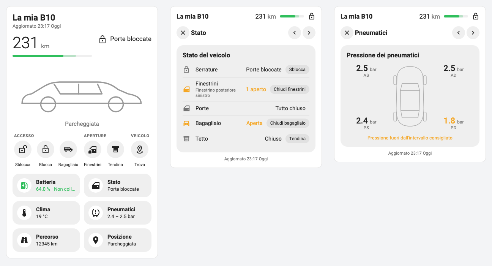
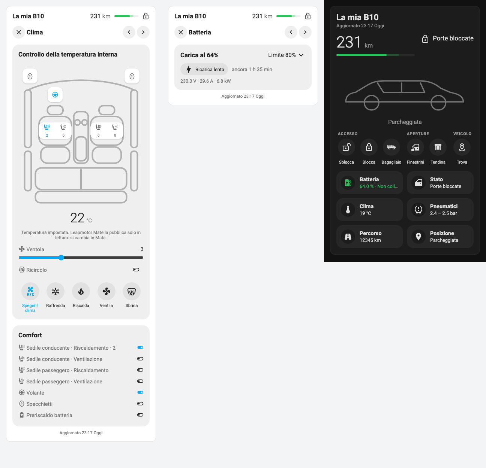
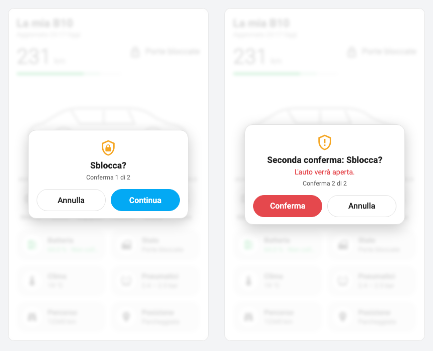

# Leapmotor Mate Card

[🇬🇧 English](README.md) · [🇮🇹 Italiano](README.it.md)

Una scheda Lovelace per Home Assistant che mostra la tua Leapmotor in modo
compatto: autonomia, batteria e stato delle serrature in alto, una riga di
pulsanti di azione e una griglia di gruppi — batteria e ricarica, stato, clima,
pneumatici, percorso e posizione — ognuno dei quali si apre al posto della
griglia.

È fatta per **[Leapmotor Mate](https://github.com/ProtossBlaster/leapmotor-mate)**
(il ponte MQTT → Home Assistant) e funziona con la **Leapmotor B10**.

È un fork di [fapgomes/ha-leapmotor-card](https://github.com/fapgomes/ha-leapmotor-card),
scritta per l'integrazione `kerniger/leapmotor-ha`. Il livello delle entità, le
azioni e il pannello del clima sono stati riscritti per Mate; l'aspetto
— impostazione, gruppi, disegni — è opera dell'autore originale. Licenza:
GPL-3.0, come l'originale.





## Requisiti

- **Leapmotor Mate**, collegato al tuo account Leapmotor, con
  **MQTT → Home Assistant** attivato.
- L'integrazione **MQTT** in Home Assistant, sullo stesso broker.
- Home Assistant 2025.1 o successivo.

Mate pubblica le entità in inglese qualunque sia la lingua di Mate o di Home
Assistant (`sensor.leapmotor_mate_5r1234_battery`, …), quindi la scheda
funziona in qualsiasi lingua.

## Installazione — HACS

1. HACS → ⋮ → **Repository personalizzati**.
2. Aggiungi `https://github.com/hubcasale/leapmotor-mate-card`, tipo **Dashboard**.
3. Cerca **Leapmotor Mate Card**, scaricala e ricarica la pagina.

HACS installa il file da una release con tag: installa una versione
(`v0.5.0` o successiva), non un commit qualsiasi.

### Manualmente

1. Scarica `leapmotor-mate-card.js` dalle
   [release](https://github.com/hubcasale/leapmotor-mate-card/releases).
2. Copialo in `config/www/leapmotor-mate-card/leapmotor-mate-card.js`.
3. **Impostazioni → Dashboard → ⋮ → Risorse → Aggiungi risorsa**:
   `/local/leapmotor-mate-card/leapmotor-mate-card.js`, tipo **Modulo JavaScript**.

Il tipo della scheda è `custom:leapmotor-mate-card`, diverso da quello
dell'originale: le due schede possono convivere.

## Configurazione

```yaml
type: custom:leapmotor-mate-card
```

Basta questo: la scheda trova l'auto da sola. Un esempio più completo:

```yaml
type: custom:leapmotor-mate-card
name: La mia B10
language: it
mate_url: http://192.168.1.10:4000
action_sections:
  - title: Ogni giorno
    actions: [lock, climate, findVehicle]
  - title: Con attenzione
    actions: [unlock, trunk, windows]
double_confirm_actions: [unlock, trunk, windows, sunshade]
disabled_actions: []
grid: [charging, status, climate, tires, trip, location]
tire_range: [2.0, 2.6]
```

| Opzione | Predefinito | Descrizione |
| --- | --- | --- |
| `device` | *(automatico)* | L'id dell'auto — gli ultimi sei caratteri del VIN, come in `leapmotor_mate_5r1234_…` — oppure il prefisso intero, o una qualsiasi entità dell'auto. Serve solo con più di un'auto Leapmotor. |
| `name` | il nome del dispositivo | Nome mostrato nell'intestazione. |
| `mate_url` | nessuno | Indirizzo dell'interfaccia web di Mate, per esempio `http://192.168.1.10:4000`. Con questo l'intestazione mostra la foto vera dell'auto — vedi sotto. |
| `language` | quella di Home Assistant | `en`, `it` o `pt`. |
| `image` | `auto` | `auto` mostra la foto dell'auto da Mate se `mate_url` è indicato, altrimenti la sagoma disegnata, `entity` solo un'immagine, `none` niente, oppure l'indirizzo della tua foto. |
| `actions` | accesso, aperture, trova, clima, ricarica | I pulsanti della riga di azioni, raggruppati per funzione in automatico — vedi sotto. |
| `action_sections` | nessuno | Le tue sezioni della riga di azioni: un elenco di `{title, actions}`. Sostituisce il raggruppamento automatico. |
| `double_confirm_actions` | `[unlock, trunk, windows, sunshade]` | Azioni che chiedono conferma **due volte** prima di aprire l'auto — vedi [Sicurezza](#sicurezza). |
| `confirm_actions` | `[]` | Azioni che chiedono conferma una volta. |
| `disabled_actions` | `[]` | Funzioni disattivate: nessun pulsante nella scheda. |
| `image_tap_action` | apre Mate | Cosa fa un tocco sull'auto. Di default apre `mate_url` in una nuova scheda; qualsiasi azione di Home Assistant, oppure `none`. |
| `grid` | tutti i gruppi | Quali gruppi mostra la griglia e in che ordine. Una voce è il nome di un gruppo oppure `{group, icon, title, summary}`. |
| `tire_range` | `[2.0, 2.6]` | Pressione normale dei pneumatici, in bar; fuori da questo intervallo un pneumatico è segnalato. |
| `map_zoom` | `15` | Zoom della mappa della posizione. |
| `color` | nessuno | Un colore proprio della scheda: lo sfondo ne prende una tinta e il bordo lo segue, come un blocco colorato della plancia. Un nome della tavolozza di Home Assistant (`blue`, `amber`, `deep-purple`…) oppure un colore CSS (`#7e57c2`). |
| `range_tap_action` | `more-info` | Cosa fa un tocco sull'autonomia (vocabolario delle azioni di Home Assistant). |
| `entities` | nessuno | Sostituisce l'entità usata da un nome logico — vedi sotto. |

### Sicurezza

Aprire l'auto da una dashboard non deve mai succedere per sbaglio.



- **Doppia conferma prima di aprire.** Sbloccare, aprire il bagagliaio, i
  finestrini e la tendina chiedono due volte (`double_confirm_actions`). La
  seconda domanda mette *Conferma* dove prima c'era *Annulla* e lo attiva solo
  dopo un istante: un doppio tocco nello stesso punto annulla. Una domanda
  lasciata senza risposta si ritira da sola dopo 20 secondi.
- **Chiede solo per aprire.** Bloccare, e chiudere bagagliaio, finestrini o
  tendina, partono subito — a meno che tu non li metta in `confirm_actions`,
  che chiede una volta.
- **Le funzioni si possono disattivare.** Ciò che è in `disabled_actions` non
  ha pulsanti nella riga di azioni, nella vista Stato né sulla pillola delle
  serrature, e dalla scheda non si può attivare in alcun modo.
- La pillola delle serrature nell'intestazione chiede sempre, in entrambi i
  versi, e `unlock`, `lock`, `trunk`, `windows` e `sunshade` sono rifiutate
  mentre l'auto è in movimento.

```yaml
# mai sbloccare o aprire il bagagliaio da questa dashboard; una conferma prima del clacson
disabled_actions: [unlock, trunk]
confirm_actions: [findVehicle]
```

### L'editor visuale

Tutte le opzioni sono nell'editor della scheda, raggruppate per funzione:
**Veicolo** (nome, auto, lingua), **Immagine e tocchi** (indirizzo di Mate,
immagine, tocco sull'auto, tocco sull'autonomia), **Azioni rapide** con le loro sezioni rinominabili,
**Sicurezza** (chiedi due volte, chiedi una volta, disattivate), **Pneumatici e
mappa**, e i **Gruppi** mostrati con il loro ordine. Scrive nello YAML solo ciò
che differisce dai valori predefiniti.

### La foto dell'auto

Mate serve la foto vera della tua auto — quella che mostra l'app Leapmotor, nel
colore della tua auto — all'indirizzo `/api/car-picture` della sua interfaccia
web. Indica `mate_url` e l'intestazione la mostra; se non si riesce a
caricarla, la scheda torna al disegno. Toccando l'auto si apre Mate (si cambia
con `image_tap_action`).

```yaml
type: custom:leapmotor-mate-card
mate_url: http://192.168.1.10:4000
```

L'indirizzo lo apre **il tuo browser**, non Home Assistant, quindi deve essere
raggiungibile da dove guardi la dashboard. Due casi in cui non si carica:

- Home Assistant è su `https` e Mate su `http` semplice: i browser lo
  bloccano. Servi anche Mate in `https`, oppure usa l'opzione qui sotto.
- Mate ha una password: la foto richiede il cookie di accesso. Usa l'opzione
  qui sotto.
- Mate risponde *«solo con una password … oppure scrivi quel nome in
  `MATE_ALLOWED_HOSTS`»*: senza password Mate risponde solo ai nomi di una rete
  di casa (un indirizzo IP, `localhost`, un nome senza punti, `.local`, `.lan`,
  …). Usa l'indirizzo IP in `mate_url`, oppure aggiungi il nome che usi a
  `MATE_ALLOWED_HOSTS` nell'ambiente di Mate e riavvialo — solo dietro una VPN o
  un proxy con autenticazione, perché da quel momento il nome raggiunge Mate
  senza protezione.

**In entrambi i casi:** apri una volta `http://<mate>:4000/api/car-picture`,
salva l'immagine in `config/www/b10.png` e imposta `image: /local/b10.png`.

### Azioni

`unlock`, `lock`, `trunk`, `windows`, `sunshade`, `findVehicle`,
`unlockCharger`, `quickCool`, `quickHeat`, `quickVentilation`, `defrost`,
`climate`, `climateOff`, `batteryPreheat`, `steeringWheelHeat`, `mirrorHeat`,
`driverSeatHeat`, `driverSeatVent`, `passengerSeatHeat`, `passengerSeatVent`.

Senza configurare nulla la riga ha cinque sezioni: **Accesso** (sblocca,
blocca, bagagliaio), **Aperture** (finestrini, tendina), **Veicolo** (trova),
**Clima** (accendi/spegni, raffredda, riscalda, sbrina) e **Ricarica** (sblocca
cavo, preriscalda batteria). Un pulsante la cui entità Mate non pubblica per la
tua auto non compare.

Con `actions` scegli i pulsanti e la scheda continua a raggrupparli per
funzione. Con `action_sections` — o *Personalizza le sezioni* nell'editor — le
sezioni sono tue: dai loro un nome, scegli cosa contiene ciascuna, le riordini.

Mate comanda la maggior parte delle funzioni con una coppia di pulsanti, quindi
la scheda trasforma un tocco nel pulsante che inverte quanto riferisce l'auto:
`trunk` apre o chiude, `sunshade` apre o chiude, `climate` preme *A/C Auto* o
*A/C Off*, la funzione di un sedile preme il suo *On* o *Off*. **Un pulsante che
Mate non pubblica non dà alcun controllo**: sulla B10 Mate nasconde i comandi
che l'auto accetta senza eseguire, e la scheda lo segue.

`unlock`, `lock`, `trunk`, `windows` e `sunshade` sono disattivate mentre l'auto
è in movimento.

### Gruppi

`charging` (batteria e limite di carica), `status` (serrature, porte,
finestrini, bagagliaio, tendina), `climate`, `tires`, `trip`, `location`. Ogni
tile mostra una riga; `summary:` sceglie quale — per la batteria `charge`
(predefinito), `battery`, `limit`, `phase`, `eta`.

### Cosa cambia dal punto di vista di Mate

- **La temperatura impostata è in sola lettura.** Mate la pubblica come sensore,
  non come regolazione; la scheda la mostra e il pannello del clima offre le
  modalità (Auto, Raffredda, Riscalda, Ventila, Sbrina, Spento), la velocità
  della ventola e il ricircolo.
- **I sedili sono acceso/spento**, con il livello riferito dall'auto accanto.
- **La tendina è apri/chiudi**, con la posizione in percentuale quando l'auto
  la comunica.
- **Percorso** mostra il contachilometri e la temperatura esterna. Viaggi e
  consumi sono nell'interfaccia web di Mate: non vengono pubblicati via MQTT.
- **Non c'è il pannello della programmazione di carica**: Mate espone il piano
  come entità di testo JSON pensata per le automazioni.
- **La posizione non indica una zona**: il tracker di Mate dice `home` ogni
  volta che ha delle coordinate, ovunque siano.
- I comandi non sono istantanei: l'auto deve svegliarsi e Mate interroga il
  cloud a intervalli, quindi il nuovo stato può richiedere un minuto.

### Entità che la scheda dice mancanti

L'avviso in fondo alla scheda le elenca per nome; passandoci sopra col mouse si
vede l'entity id con cui è stata cercata ciascuna. La scheda trova le entità in
due modi:

1. **Con la chiave interna di Mate**, letta dal registro delle entità (lo
   `unique_id` di Home Assistant, `…_mate_<VIN>_door_driver`). Resiste agli
   entity id rinominati e ai vecchi id che Home Assistant conserva per le
   entità create da un Mate precedente (`door_driver` dove oggi il nome darebbe
   `door_front_left`). Leggere il registro richiede un account amministratore.
2. **Con l'entity id**, `<dominio>.leapmotor_mate_<id>_<nome>`, per tutti.

Ciò che resta nell'elenco è un'entità che Mate non pubblica per la tua auto
(Mate nasconde i comandi che non funzionano e le temperature che l'auto non
comunica mai). Per usare al suo posto un'altra entità, falla corrispondere:

### Sostituire le entità

`entities:` sostituisce l'entità dietro un nome logico, per un entity_id
rinominato o per un'auto che Mate pubblica in modo diverso:

```yaml
entities:
  battery: sensor.la_mia_b10_battery
  lock: lock.la_mia_b10_door_lock
```

I nomi sono le chiavi di `ENTITY_KEYS` in [`src/keys.ts`](src/keys.ts)
(`battery`, `range`, `lock`, `trunk`, `tireFL`, `doorDriver`, `openTrunk`, …).

### Toccare l'intestazione

Il numero dell'autonomia apre la finestra di dettaglio del sensore da cui
proviene (cambia con `range_tap_action`, oppure `none`). La pillola *Porte
bloccate* blocca o sblocca l'auto, sempre dopo una conferma.

## Sviluppo

```bash
npm ci
npm test          # test unitari e un test di rendering in un DOM
npm run typecheck
npm run build     # dist/leapmotor-mate-card.js
npm run demo      # demo/index.html: la scheda con un'auto Mate finta, senza Home Assistant
```

Le release sono costruite dal workflow `build` quando si carica un tag `v*`.

## Crediti e licenza

Scheda originale di [fapgomes](https://github.com/fapgomes/ha-leapmotor-card);
dati dell'auto da [Leapmotor Mate](https://github.com/ProtossBlaster/leapmotor-mate)
(ProtossBlaster). I disegni delle auto sono quelli della scheda originale e non usano
grafiche Leapmotor.

GPL-3.0-or-later — vedi [LICENSE](LICENSE).
