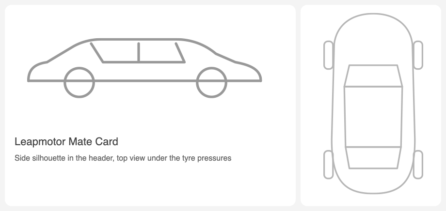

# Leapmotor Mate Card

[🇬🇧 English](README.md) · [🇮🇹 Italiano](README.it.md)

A Lovelace card for Home Assistant that shows your Leapmotor as a compact
card: range, battery and lock state at the top, a row of action buttons, and a
grid of groups — battery and charging, status, climate, tyres, trip and
location — each opening in place of the grid.

It is built for **[Leapmotor Mate](https://github.com/ProtossBlaster/leapmotor-mate)**
(the MQTT → Home Assistant bridge) and works with the **Leapmotor B10**.

This is a fork of [fapgomes/ha-leapmotor-card](https://github.com/fapgomes/ha-leapmotor-card),
which was written for the `kerniger/leapmotor-ha` integration. The entity
layer, the actions and the climate panel were rewritten for Mate; the look —
layout, groups, drawings — is the original author's work. Licence:
GPL-3.0, like the original.



## Requirements

- **Leapmotor Mate**, connected to your Leapmotor account, with
  **MQTT → Home Assistant** turned on.
- The **MQTT** integration in Home Assistant, on the same broker.
- Home Assistant 2025.1 or later.

Mate publishes its entities in English whatever the language of Mate or of
Home Assistant (`sensor.leapmotor_mate_5r1234_battery`, …), so the card works
in any language.

## Installation — HACS

1. HACS → ⋮ → **Custom repositories**.
2. Add `https://github.com/hubcasale/leapmotor-mate-card`, type **Dashboard**.
3. Search for **Leapmotor Mate Card** and download it, then reload the page.

HACS installs the file from a tagged release, so install a version
(`v0.5.0` or later), not an arbitrary commit.

### Manually

1. Download `leapmotor-mate-card.js` from the
   [releases](https://github.com/hubcasale/leapmotor-mate-card/releases).
2. Copy it to `config/www/leapmotor-mate-card/leapmotor-mate-card.js`.
3. **Settings → Dashboards → ⋮ → Resources → Add**:
   `/local/leapmotor-mate-card/leapmotor-mate-card.js`, type **JavaScript module**.

The card type is `custom:leapmotor-mate-card`, different from the original's,
so both can be installed side by side.

## Configuration

```yaml
type: custom:leapmotor-mate-card
```

That is all: the card finds your car by itself. A fuller example:

```yaml
type: custom:leapmotor-mate-card
name: My B10
language: en
actions: [unlock, lock, trunk, windows, findVehicle, sunshade]
confirm_actions: [unlock]
grid: [charging, status, climate, tires, trip, location]
tire_range: [2.0, 2.6]
```

| Option | Default | Description |
| --- | --- | --- |
| `device` | *(automatic)* | The car's id — the last six characters of its VIN, as in `leapmotor_mate_5r1234_…` — or the whole prefix, or any entity of the car. Only needed with more than one Leapmotor car. |
| `name` | the device name | Name shown in the header. |
| `mate_url` | none | Address of Mate's web interface, e.g. `http://192.168.1.10:4000`. With it the header shows the car's own picture — see below. |
| `language` | Home Assistant's | `en`, `it` or `pt`. |
| `image` | `auto` | `auto` shows the car's picture from Mate if `mate_url` is set, else the drawn silhouette, `entity` only a picture, `none` nothing, or a URL of your own photo. |
| `actions` | `[unlock, lock, trunk, windows, findVehicle, sunshade]` | The buttons of the action row — see below. |
| `confirm_actions` | `[unlock]` | Actions that ask for confirmation first. |
| `grid` | all groups | Which groups the grid shows, and in what order. An entry is a group name or `{group, icon, title, summary}`. |
| `tire_range` | `[2.0, 2.6]` | Normal tyre pressure, in bar; outside it a tyre is flagged. |
| `map_zoom` | `15` | Zoom of the location map. |
| `range_tap_action` | `more-info` | What a tap on the range does (Home Assistant's action vocabulary). |
| `entities` | none | Overrides which entity a logical name uses — see below. |

### The car's picture

Mate serves the car's own picture — the one the Leapmotor app shows, in your
car's colour — at `/api/car-picture` of its web interface. Set `mate_url` and
the header shows it; if it cannot be loaded the card falls back to the drawing.

```yaml
type: custom:leapmotor-mate-card
mate_url: http://192.168.1.10:4000
```

The address is opened by **your browser**, not by Home Assistant, so it must be
reachable from where you look at the dashboard. Two cases where it will not
load:

- Home Assistant is on `https` and Mate on plain `http`: browsers block that.
  Serve Mate over `https` too, or use the next option.
- Mate has a password set: the picture needs the login cookie. Use the next
  option.
- Mate answers *"only with a password … or name this host in
  `MATE_ALLOWED_HOSTS`"*: without a password Mate only answers on the names of
  a home network (an IP address, `localhost`, a name without dots, `.local`,
  `.lan`, …). Use the IP address in `mate_url`, or add the name you use to
  `MATE_ALLOWED_HOSTS` in Mate's environment and restart it — only behind a VPN
  or an authenticating proxy, because the name then reaches Mate unprotected.

**Either way:** open `http://<mate>:4000/api/car-picture` once, save the image
to `config/www/b10.png` and set `image: /local/b10.png`.

### Actions

`unlock`, `lock`, `trunk`, `windows`, `sunshade`, `findVehicle`,
`unlockCharger`, `quickCool`, `quickHeat`, `quickVentilation`, `defrost`,
`climate`, `climateOff`, `batteryPreheat`, `steeringWheelHeat`, `mirrorHeat`,
`driverSeatHeat`, `driverSeatVent`, `passengerSeatHeat`, `passengerSeatVent`.

Mate commands most functions with a pair of buttons, so the card turns a tap
into the button that reverses what the car reports: `trunk` opens or closes,
`sunshade` opens or closes, `climate` presses *A/C Auto* or *A/C Off*, a seat
function presses its *On* or *Off*. **A button Mate does not publish gives no
control** — on the B10, Mate hides the commands that the car accepts without
carrying out, and the card follows.

`unlock`, `lock`, `trunk`, `windows` and `sunshade` are disabled while the car
is moving.

### Groups

`charging` (battery and charge limit), `status` (locks, doors, windows, trunk,
sunshade), `climate`, `tires`, `trip`, `location`. Each tile shows one line;
`summary:` picks which — for the battery tile `charge` (default),
`battery`, `limit`, `phase`, `eta`.

### What is different from Mate's point of view

- **Target temperature is read-only.** Mate publishes it as a sensor, not as a
  setting; the card shows it and the climate panel gives the modes (Auto, Cool,
  Heat, Ventilation, Defrost, Off), the fan speed and the recirculation.
- **Seats are on/off**, with the level the car reports shown beside them.
- **The sunshade is open/close**, with its position in percent shown when the
  car reports it.
- **Trip** shows the odometer and the outside temperature. Trips and
  consumption are in Mate's own web interface; they are not published over MQTT.
- **There is no charging schedule panel**: Mate exposes the plan as a JSON
  text entity meant for automations.
- **The location tile names no zone**: Mate's tracker says `home` whenever it
  has coordinates, wherever they are.
- Commands are not instantaneous: the car has to wake up and Mate polls the
  cloud at intervals, so the new state can take a minute.

### Entities the card says are missing

The warning at the bottom of the card lists them by name; hover it to see the
entity id each one was looked for under. The card finds entities two ways:

1. **By Mate's own key**, read from the entity registry (Home Assistant's
   `unique_id`, `…_mate_<VIN>_door_driver`). This survives renamed entity ids,
   and the older ids Home Assistant keeps for entities created by an earlier
   Mate (`door_driver` where today's name would give `door_front_left`). Reading
   the registry needs an administrator account.
2. **By entity id**, `<domain>.leapmotor_mate_<id>_<name>`, for everyone.

What is still listed is an entity Mate does not publish for your car (Mate hides
the commands that do not work on it, and the temperatures a car never
reports). To use some other entity in its place, map it:

### Entity overrides

`entities:` replaces the entity behind a logical name, for a renamed entity
id or a car Mate publishes differently:

```yaml
entities:
  battery: sensor.my_b10_battery
  lock: lock.my_b10_door_lock
```

The names are the keys of `ENTITY_KEYS` in
[`src/keys.ts`](src/keys.ts) (`battery`, `range`, `lock`, `trunk`,
`tireFL`, `doorDriver`, `openTrunk`, …).

### Tapping the header

The range number opens the more-info dialog of the sensor it comes from (set
`range_tap_action` to change that, or `none`). The *Doors locked* pill locks or
unlocks the car, always after a confirmation.

## Development

```bash
npm ci
npm test          # unit tests and a render test in a DOM
npm run typecheck
npm run build     # dist/leapmotor-mate-card.js
```

Releases are built by the `build` workflow when a `v*` tag is pushed.

## Credits and licence

Original card by [fapgomes](https://github.com/fapgomes/ha-leapmotor-card);
car data by [Leapmotor Mate](https://github.com/ProtossBlaster/leapmotor-mate)
(ProtossBlaster). The car drawings are the original card's and do not use
Leapmotor artwork.

GPL-3.0-or-later — see [LICENSE](LICENSE).
